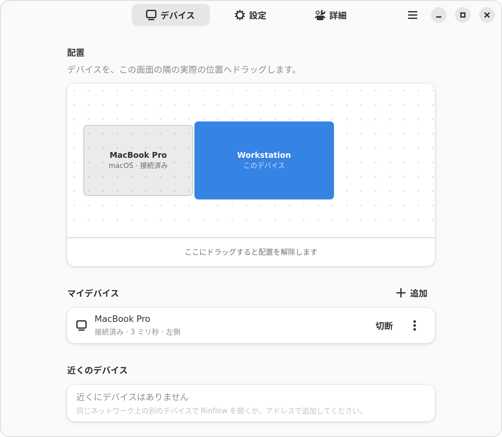

<p align="center">
  <picture>
    <source media="(prefers-color-scheme: dark)" srcset="docs/logo/rinflow-dark.svg">
    
  </picture>
</p>

<h1 align="center">Rinflow for Linux</h1>

<p align="center">
  1 組のキーボードとマウスで、Linux、Mac、Windows PC を操作できます。<br>
  ポインターを画面の端の先へ動かすと、隣のデバイスに移ります。
</p>

<p align="center">
  <a href="README.md">English</a> · <a href="README.zh-CN.md">简体中文</a> · <b>日本語</b>
</p>

<p align="center">
  <picture>
    <source media="(prefers-color-scheme: dark)" srcset="docs/images/devices-ja-JP-dark.png">
    
  </picture>
</p>

> [!NOTE]
> Rinflow は開発の初期段階です。既知の問題は[変更履歴](CHANGELOG.md)をご覧ください。

## 機能

- **画面端での切り替え**：ポインターを画面の端の先へ動かすと、隣のデバイスを操作できます。**Ctrl+Alt+Esc** で戻ります。
- **配置**：デバイスを、画面の隣の実際の位置へドラッグします。
- **ペアリングと暗号化**：新しいデバイスは 6 桁のコードを確認し、すべての接続に TLS 1.3 を使用します。
- **クリップボードとファイル**：テキスト、画像、コピーしたファイルがポインターと一緒に移動します。ファイルは貼り付け時に転送されます。
- **トレイアイコンとコマンドライン**：よく使う切り替えは、トレイメニューと `rinflowctl` から操作できます。
- **言語**：英語、簡体字中国語、日本語。

[Rinflow for macOS](https://github.com/rinflow-dev/rinflow-macos) と [Rinflow for Windows](https://github.com/rinflow-dev/rinflow-windows) に対応し、[rinflow-core](https://github.com/rinflow-dev/rinflow-core) を基盤としています。

## システム要件

- GNOME 45 または KDE Plasma 6.1 以降の Wayland セッション、または任意のデスクトップの X11 セッション（Cinnamon、Xfce、MATE など）
- Debian 13、Ubuntu 24.04 以降（x86_64 または arm64）
- 同じローカルネットワーク上で Rinflow を実行している別のコンピューター

## インストール

[最新リリース](https://github.com/rinflow-dev/rinflow-linux/releases/latest)からお使いのマシン用のパッケージをダウンロードし（Intel と AMD は `amd64`、ARM は `arm64`）、次を実行します：

```sh
sudo apt install ./rinflow_0.0.1-1_amd64.deb
```

## 使い方

1. 両方のコンピューターで Rinflow を開きます。Wayland では、デスクトップが Rinflow によるポインターとキーボードの操作を許可するか尋ねるので、許可します。
2. 相手のコンピューターの横にある**接続**を選び、両方に同じ 6 桁のコードが表示されていることを確認します。
3. 相手のコンピューターを、画面の隣の実際の位置へドラッグします。
4. その側の画面端の先へポインターを動かします。

## ソースからビルド

Rust、GTK 4、libadwaita、`blueprint-compiler`、`gettext`、`cargo-deb` が必要です。詳しくは[ビルドと実行](docs/building.md)（英語）をご覧ください。

```sh
git clone https://github.com/rinflow-dev/rinflow-linux.git
cd rinflow-linux
make deb    # target/debian/rinflow_*.deb
```

## ドキュメント

- [ビルドと実行](docs/building.md)（英語）
- [設計](docs/design.md)：各機能の Linux での実装（英語）
- [状況](docs/status.md)：何をどこでテストしたか（英語）

## ライセンス

[Mozilla Public License 2.0](LICENSE)。`data/icons/scalable/` のシンボリックアイコンは GNOME Adwaita アイコンテーマ（CC BY-SA 3.0 / LGPL 3）のものです。
