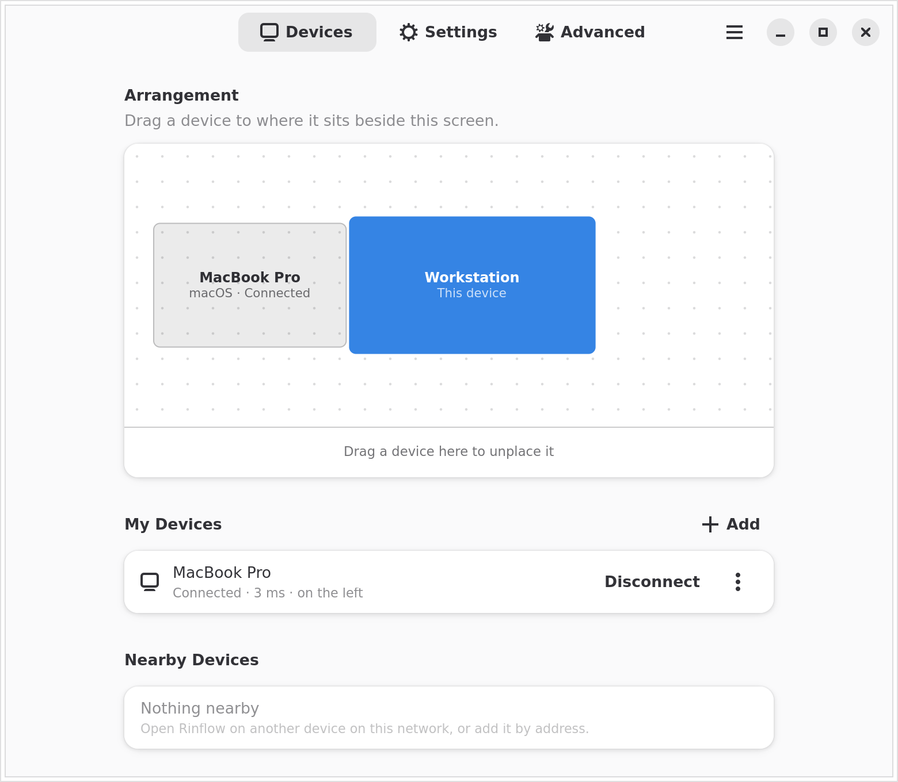

<p align="center">
  <picture>
    <source media="(prefers-color-scheme: dark)" srcset="docs/logo/rinflow-dark.svg">
    
  </picture>
</p>

<h1 align="center">Rinflow for Linux</h1>

<p align="center">
  One keyboard and mouse for your Linux machines, Macs and Windows PCs.<br>
  Move the pointer past a screen edge, and it continues on the next device.
</p>

<p align="center">
  <b>English</b> · <a href="README.zh-CN.md">简体中文</a> · <a href="README.ja.md">日本語</a>
</p>

<p align="center">
  <picture>
    <source media="(prefers-color-scheme: dark)" srcset="docs/images/devices-en-US-dark.png">
    
  </picture>
</p>

> [!NOTE]
> Rinflow is in early development. Known issues are listed in the [changelog](CHANGELOG.md).

## Features

- **Edge switching**: push the pointer past a screen edge to control the next device. **Ctrl+Alt+Esc** brings it back.
- **Arrangement**: drag devices into place around your screen.
- **Pairing and encryption**: new devices confirm a six-digit code, and every connection uses TLS 1.3.
- **Clipboard and files**: text, images and copied files follow the pointer. Files are transferred when you paste them.
- **Tray icon and command line**: the tray menu and `rinflowctl` cover the everyday switches.
- **Languages**: English, Simplified Chinese and Japanese.

Works with [Rinflow for macOS](https://github.com/rinflow-dev/rinflow-macos) and [Rinflow for Windows](https://github.com/rinflow-dev/rinflow-windows), and is built on [rinflow-core](https://github.com/rinflow-dev/rinflow-core).

## Requirements

- GNOME 45 or KDE Plasma 6.1, or later, in a Wayland session; or any desktop in an X11 session (Cinnamon, Xfce, MATE and others)
- Debian 13, Ubuntu 24.04, or later (x86_64 or arm64)
- Another computer running Rinflow, on the same local network

## Install

Download the package for your machine from the [latest release](https://github.com/rinflow-dev/rinflow-linux/releases/latest) (`amd64` for Intel and AMD, `arm64` for ARM), then:

```sh
sudo apt install ./rinflow_0.0.1-1_amd64.deb
```

## Getting started

1. Open Rinflow on both computers. On Wayland the desktop asks whether Rinflow may control the pointer and keyboard: allow it.
2. Select **Connect** next to the other computer, and check that both show the same six-digit code.
3. Drag the other computer to the side of your screen where it sits.
4. Push the pointer past that edge.

## Build from source

You need Rust, GTK 4, libadwaita, `blueprint-compiler`, `gettext` and `cargo-deb`. Details are in [Building and running](docs/building.md).

```sh
git clone https://github.com/rinflow-dev/rinflow-linux.git
cd rinflow-linux
make deb    # target/debian/rinflow_*.deb
```

## Documentation

- [Building and running](docs/building.md)
- [Design](docs/design.md): how each feature works on Linux
- [Status](docs/status.md): what has been tested, and where

## License

[Mozilla Public License 2.0](LICENSE). The symbolic icons under `data/icons/scalable/` come from the GNOME Adwaita icon theme (CC BY-SA 3.0 / LGPL 3).
