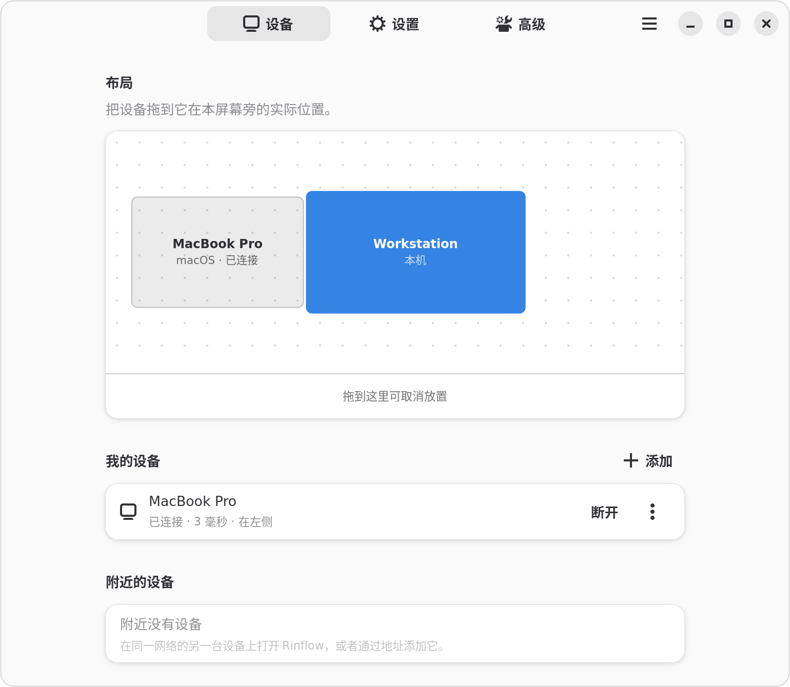

<p align="center">
  <picture>
    <source media="(prefers-color-scheme: dark)" srcset="docs/logo/rinflow-dark.svg">
    
  </picture>
</p>

<h1 align="center">Rinflow for Linux</h1>

<p align="center">
  一套键盘鼠标，控制你的 Linux、Mac 和 Windows 电脑。<br>
  把指针推过屏幕边缘，它就出现在旁边那台设备上。
</p>

<p align="center">
  <a href="README.md">English</a> · <b>简体中文</b> · <a href="README.ja.md">日本語</a>
</p>

<p align="center">
  <picture>
    <source media="(prefers-color-scheme: dark)" srcset="docs/images/devices-zh-CN-dark.png">
    
  </picture>
</p>

> [!NOTE]
> Rinflow 仍处于早期开发阶段。已知问题见[更新日志](CHANGELOG.md)。

## 功能

- **边缘切换**：把指针推过屏幕边缘，就能控制旁边的设备。按 **Ctrl+Alt+Esc** 回到本机。
- **布局**：把设备拖到它在屏幕旁的实际位置。
- **配对与加密**：新设备需要核对六位数字，所有连接都使用 TLS 1.3。
- **剪贴板与文件**：文字、图片和复制的文件跟着指针走。文件在粘贴时才传输。
- **托盘图标与命令行**：常用开关在托盘菜单和 `rinflowctl` 里都能操作。
- **语言**：英文、简体中文和日文。

可与 [Rinflow for macOS](https://github.com/rinflow-dev/rinflow-macos) 和 [Rinflow for Windows](https://github.com/rinflow-dev/rinflow-windows) 互通，基于 [rinflow-core](https://github.com/rinflow-dev/rinflow-core) 构建。

## 系统要求

- GNOME 45 或 KDE Plasma 6.1 及以上的 Wayland 会话；或任意桌面的 X11 会话（Cinnamon、Xfce、MATE 等）
- Debian 13、Ubuntu 24.04 及以上（x86_64 或 arm64）
- 同一局域网内另一台运行 Rinflow 的电脑

## 安装

从[最新版本](https://github.com/rinflow-dev/rinflow-linux/releases/latest)下载对应的安装包（Intel 和 AMD 选 `amd64`，ARM 选 `arm64`），然后执行：

```sh
sudo apt install ./rinflow_0.0.1-1_amd64.deb
```

## 开始使用

1. 在两台电脑上打开 Rinflow。在 Wayland 上，桌面会询问是否允许 Rinflow 控制指针和键盘，选择允许。
2. 点击另一台电脑旁的**连接**，确认两边显示的六位数字相同。
3. 把另一台电脑拖到它在你屏幕旁的实际位置。
4. 把指针推过那一侧的屏幕边缘。

## 从源码构建

需要 Rust、GTK 4、libadwaita、`blueprint-compiler`、`gettext` 和 `cargo-deb`。详见[构建与运行](docs/building.md)（英文）。

```sh
git clone https://github.com/rinflow-dev/rinflow-linux.git
cd rinflow-linux
make deb    # target/debian/rinflow_*.deb
```

## 文档

- [构建与运行](docs/building.md)（英文）
- [设计](docs/design.md)：各项功能在 Linux 上的实现（英文）
- [状态](docs/status.md)：测试过什么、在哪里测的（英文）

## 许可证

[Mozilla Public License 2.0](LICENSE)。`data/icons/scalable/` 下的符号图标来自 GNOME Adwaita 图标主题（CC BY-SA 3.0 / LGPL 3）。
